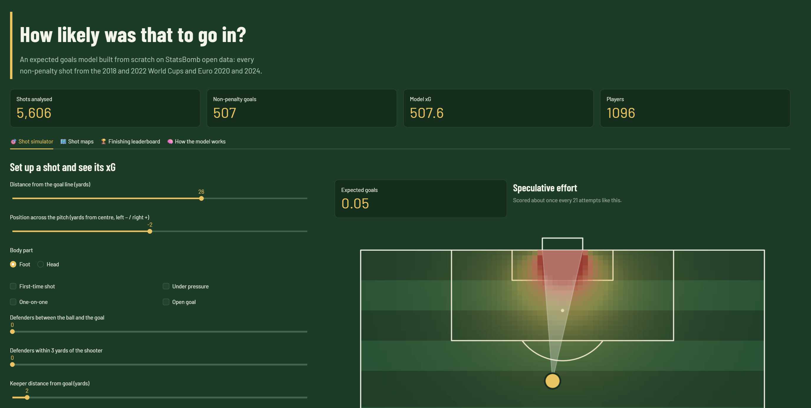
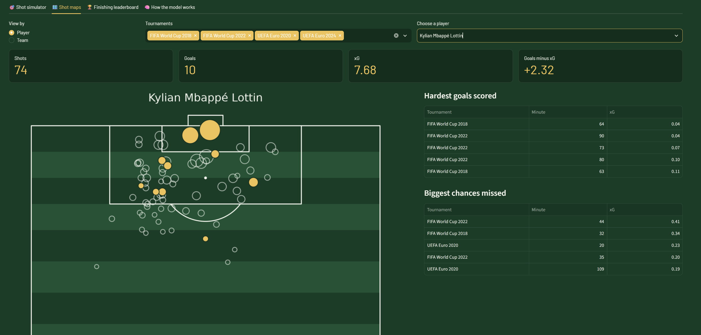

# ⚽ Expected Goals (xG) Model: how likely was that shot to go in?

[](https://YOUR-APP-NAME.streamlit.app)

**Live app: [YOUR-APP-NAME.streamlit.app](https://YOUR-APP-NAME.streamlit.app)**

A home-made expected goals model, built from scratch on StatsBomb open data: every shot from the 2018 and 2022 World Cups, Euro 2020 and Euro 2024. It turns raw match events into a number that every professional club uses today, then puts that number into an interactive app.



---

## What is xG, in one minute

Not every shot is equal. A tap-in from two yards and a speculative strike from 35 yards both count as "one shot", but one of them goes in almost every time and the other almost never.

**Expected goals (xG)** gives each shot a probability of being scored, between 0 and 1. A shot worth 0.30 xG is scored about 3 times out of 10 by an average player. Adding up a player's xG tells you how many goals they *should* have scored given the chances they had. Comparing that with the goals they actually scored tells you who finishes better, or worse, than expected.

Clubs use xG to scout strikers, to judge whether a team is creating good chances or just lots of bad ones, and to tell luck apart from quality.

---

## What the app does

The app has four tabs.

**🎯 Shot simulator.** Set up any shot yourself: where it is taken from, foot or header, first time or not, how many defenders are in the way, where the goalkeeper is standing. The app instantly gives its xG, describes the chance (half-chance, good chance, big chance), and draws a heatmap of that same shot from every spot on the pitch. It also tells you how often real shots from that area were actually scored.

**🗺️ Shot maps.** Pick any player or team and see every shot they took on a pitch, sized by xG, with goals highlighted. Next to the map: their hardest goals (lowest xG) and their biggest missed chances (highest xG).



**🏆 Finishing leaderboard.** Ranks players by **goals minus xG**, the classic measure of finishing. Who scored more than their chances deserved, and who wasted the most? Filter by tournament and minimum number of shots.

**🧠 How the model works.** The evaluation results, the calibration chart and which factors matter most for the model.

---

## What the data says: football findings

**Distance and angle decide almost everything.** Shots from inside 6 yards are scored about 40% of the time, shots from 30 to 40 yards about 1.4%. The angle to goal is the second strongest factor.

**Headers look better than they are.** At first glance, headers were scored *more* often than shots with the foot (10.4% vs 8.7%). That's because headers are taken much closer to goal. Compared at the same distance, the foot wins every time: between 6 and 12 yards, 23% of foot shots go in against 10% of headers. The model learned this correctly.

**One defender in the way halves your chances.** Using StatsBomb's freeze frames (the position of every player at the moment of the shot), I counted the defenders standing between the ball and the goal. With nobody in the way, 12.7% of shots are scored. With one defender, 6.7%. This home-made feature turned out to be far more informative than StatsBomb's simple "under pressure" flag.

**Euro 2024 was a tournament of poor finishing.** The model expected 109.7 non-penalty goals from the chances created. Players scored 98. StatsBomb's own model shows the same gap.

**Mbappé is a left-side finisher.** 10 non-penalty goals from 7.7 xG across the four tournaments (+2.3). His shot map shows most of his attempts come from the left side of the box, cutting inside: his playing style shows up in the data without the model knowing his position.

**The top of the finishing leaderboard is full of long-range shooters.** Xherdan Shaqiri (6 goals from 1.7 xG), Luka Modrić and Patrik Schick all scored spectacular goals from distance. One goal from a 0.03 xG shot adds almost +1 on its own, so over 20 to 30 shots, luck plays a big part. Harry Kane (+3.1 over 53 shots) and Mbappé (+2.3 over 74 shots) have smaller but statistically more solid surpluses.

---

## How it was built, in plain terms

### 1. Data
5,829 shots from 230 matches, downloaded with [`statsbombpy`](https://github.com/statsbomb/statsbombpy). Penalties are removed (they follow different rules and are scored about 75% of the time), leaving **5,606 shots**.

### 2. Features: what the model looks at
| Feature | What it means |
|---|---|
| Distance | Yards from the shot to the centre of the goal |
| Angle | How much of the goal mouth the shooter can see |
| Header | Shot with the head or not |
| First-time, one-on-one, open goal, under pressure | Context of the shot |
| Defenders in the shot cone | Defenders inside the triangle between the ball and the two posts |
| Defenders within 3 yards | Defenders closing down the shooter |
| Keeper distance from goal | How far the goalkeeper is from his line |

The last three were computed from StatsBomb's freeze frames, using a bit of geometry (point-in-triangle tests).

### 3. Model
A **logistic regression**, the classic model for probabilities, inside a scikit-learn pipeline (missing values filled in, features put on the same scale). A tuned **XGBoost** was also tested and performed worse, so the simpler and more explainable model was kept.

### 4. Honest evaluation
The model was trained on the 2018 and 2022 World Cups and Euro 2020, then tested on **Euro 2024, a tournament it had never seen**, just like a club using past data to judge future matches.

| Model | Log loss ↓ | Brier score ↓ | ROC AUC ↑ |
|---|---|---|---|
| Naive baseline (same xG for every shot) | 0.2692 | 0.0699 | 0.500 |
| XGBoost, tuned by cross-validation | 0.2357 | 0.0641 | 0.754 |
| **Logistic regression (this project)** | **0.2324** | **0.0634** | **0.767** |
| StatsBomb's commercial xG | 0.2251 | 0.0615 | 0.787 |

With only 4,300 training shots, the model captures about **83% of the improvement** StatsBomb's professional model makes over the naive baseline. The calibration check confirms that when the model says 20%, about 20% of those shots are actually scored.

In the app, every shot's xG comes from a model that never saw that shot during training (out-of-fold predictions), so the finishing leaderboard is not biased.

---

## Project structure

```
├── app/
│   ├── app.py              # Streamlit app
│   └── shots_xg.csv        # Shots with their xG, used by the app
├── models/
│   └── xg_model.joblib     # Trained model
├── notebooks/
│   ├── 01_exploration.ipynb
│   ├── 02_features.ipynb
│   ├── 03_modeling.ipynb
│   └── 04_analysis.ipynb
├── src/
│   ├── data_loader.py      # Downloads the shots from StatsBomb
│   ├── features.py         # Feature engineering
│   ├── train.py            # Trains and saves the model
│   └── export_app_data.py  # Prepares the app data
├── .streamlit/config.toml  # App theme
├── requirements.txt        # What the app needs
└── requirements-dev.txt    # Everything needed to rebuild the project
```

## Run it locally

```bash
git clone https://github.com/mazetrade/Football_goals_analysis.git
cd Football_goals_analysis
python -m venv .venv
.venv\Scripts\activate          # on Mac/Linux: source .venv/bin/activate
pip install -r requirements-dev.txt

python src/data_loader.py       # download the data (5 to 10 minutes)
python src/train.py             # train the model
python src/export_app_data.py   # prepare the app data
streamlit run app/app.py
```

## Limitations and next steps

- StatsBomb's freeze frames do not include the height of the ball or the shooter's strong foot, two things that matter a lot for a shot.
- International tournaments only: adding full league seasons would give many more shots and a stronger model.
- Small samples: over a few dozen shots, "goals minus xG" mixes skill and luck.
- Data quirk spotted during the checks: penalties in the 2018 World Cup are often recorded one yard away from the penalty spot used in the other tournaments.

## Credits

Data: [StatsBomb Open Data](https://github.com/statsbomb/open-data). Built with pandas, scikit-learn, XGBoost, mplsoccer and Streamlit.

Author: **Mazen Ismail**, [github.com/mazetrade](https://github.com/mazetrade)